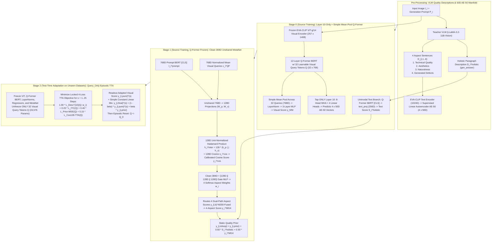
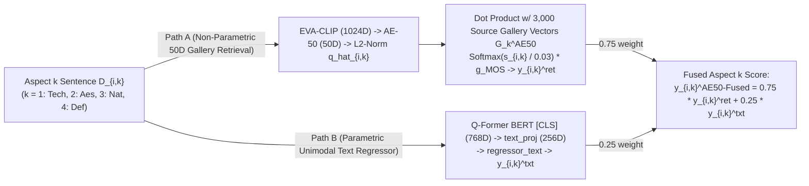
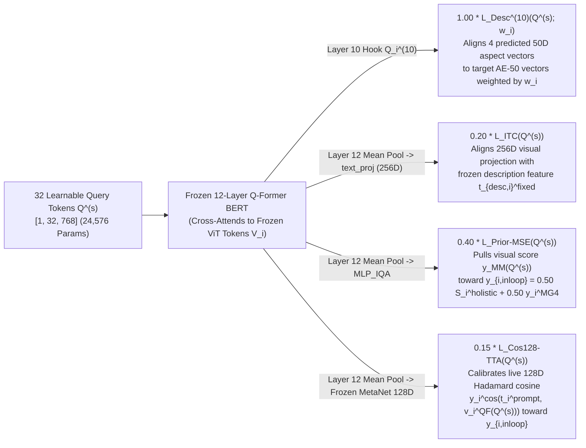

# Complete Master Guide to Our Final Locked Method (`Pipeline A`):
## Layer-10 Multi-Aspect Q-Former, 128D Hadamard `MetaNet`, and `Query_Only` Episodic Test-Time Adaptation

> [!IMPORTANT]
> **Who This Document Is For**:
> This guide is written so that **anyone — even someone who has never heard of Image Quality Assessment (IQA), BLIP-2 Q-Former, or Test-Time Adaptation (TTA)** — can understand:
> 1. **What problem we are solving** and why standard deep learning models fail on unseen AI-generated images.
> 2. **What every single variable, symbol, and tensor means**, its exact shape, and how it is derived (from the image, the prompt, the Vision-Language Model teacher, the 3,000-image reference gallery, the Q-Former, or `MetaNet`).
> 3. **How all 3 stages of our final locked method (`Pipeline A`) work step-by-step**, with exact equations and diagrams.
> 4. **All final experimental results** across unseen benchmarks (`EvalMI-Val`, `AGHI-QA`, `AGIQA-20K`, and `Q-Eval`).

---

## Part 1: Beginner-Friendly Foundations (What Is NR-IQA & What Is Test-Time Adaptation?)

### 1.1 What Is No-Reference Image Quality Assessment (NR-IQA) for AI-Generated Images?
When a text-to-image generator (such as Stable Diffusion, Midjourney, FLUX, or DALL-E) creates an image $I_i$ from a text prompt $P_i$, the generated image can suffer from many types of quality issues:
1. **Technical Artifacts**: Blur, pixelation, noise, over-smoothing, or muddy textures.
2. **Aesthetic Flaws**: Poor lighting, awkward composition, or clashing colors.
3. **Unnaturalness**: Plastic-looking human skin, impossible shadows, or floating objects.
4. **AI Structural Defects**: Six fingers on a hand, asymmetric eyes, melted background geometry, or missing limbs.

In **No-Reference Image Quality Assessment (NR-IQA)**, there is no "ground-truth pristine reference image" to compare against. Given only the AI-generated image $I_i$ and its text prompt $P_i$, our model must predict a single scalar quality score $\hat{y}_i \in [0, 1]$ that matches the **Mean Opinion Score (MOS)** $y_i^{\text{GT}} \in [0, 1]$ averaged across human raters.

#### How Do We Measure Success?
We evaluate predictions across a test dataset of $N$ images using two standard correlation metrics (higher is better, max $= 1.0000$):
* **SRCC (Spearman Rank-Order Correlation Coefficient)**: Measures whether the model ranks images in the **exact same order** from worst to best as human raters (monotonic ranking accuracy).
* **PLCC (Pearson Linear Correlation Coefficient)**: Measures how closely the predicted scores match the human scores **linearly**.

---

### 1.2 The Core Problem: Why Standard Models Collapse on New Datasets ("Cross-Dataset Drift")
Suppose we train a strong Vision-Language model (a **BLIP-2 Q-Former**) on a large source dataset (`EvalMI-50K`). On the source test split, it achieves **`0.8784` SRCC / `0.9118` PLCC** — nearly human-level agreement.

However, the moment we test that exact same frozen model (**Zero-Shot, `ZS`**) on **unseen target datasets** created by different AI generators, different prompt styles, and different human rating protocols, performance drops sharply:
* **`AGIQA-20K`** (20,000 images from diverse diffusion/GAN models): drops from `0.8784` $\to$ **`0.7609` SRCC**
* **`AGHI-QA`** (Human-centric AI images with subtle hand/face anatomy defects): drops from `0.8784` $\to$ **`0.5253` SRCC**
* **`Q-Eval`** (Modern multi-generator benchmark with complex prompts): drops from `0.8784` $\to$ **`0.3972` SRCC**

**Why does this happen?**
1. **Visual Shift**: New generators produce unfamiliar textures and artifact patterns that the frozen visual queries do not recognize.
2. **Aspect Priority Shift**: On a portrait dataset (`AGHI-QA`), a single deformed hand ruins the score (`Generated Defects` dominates). On an artistic painting dataset, distorted geometry may be intentional cubist style (`Aesthetics` dominates). A static regressor uses fixed weights everywhere.

---

### 1.3 What Is Test-Time Adaptation (TTA) & Why Is Ours "Episodic"?
When evaluating on a new target dataset at test time, **we do NOT have ground-truth human MOS labels $y_i^{\text{GT}}$**.
* **Standard Inference (Zero-Shot)**: Keep all model weights frozen and output $\hat{y}_i^{\text{ZS}}$ in one forward pass. If the model is miscalibrated for the new domain, its errors remain permanently.
* **Test-Time Adaptation (TTA)**: Before outputting the final score for a test batch of images, we use **label-free self-supervised signals** (derived from Vision-Language descriptions of the image and our 3,000-image source prototype gallery) to take $T = 25$ small gradient steps that adapt a tiny, flexible subset of the model's parameters (**only the 32 visual query tokens $\mathbf{Q}$, just `24,576` numbers = `0.02%` of the model**) specifically for the current test images.
* **Why "Episodic Reset" ($\mathbf{Q} \leftarrow \mathbf{Q}_0$)?**
  If we kept updating the model continuously across thousands of test batches without ground-truth labels, errors would accumulate and the weights would eventually drift or collapse. Instead, our TTA is **episodic**:
  1. Start from the clean pretrained query tokens $\mathbf{Q}_0$.
  2. Adapt $\mathbf{Q}$ for $s = 1, \dots, 25$ gradient steps on the current test batch.
  3. Output the adapted quality score $\hat{y}_{i,\text{final}}$.
  4. **Immediately reset $\mathbf{Q} \leftarrow \mathbf{Q}_0$** before the next test batch!

---

### 1.4 High-Level Architecture Diagram of Our Locked Method (`Pipeline A`)



---

## Part 2: Complete Dictionary of Every Variable & How Each Is Derived

Use this reference table whenever you want to look up any symbol in our equations, its exact dimensions, how it is computed, and what it means physically:

| Symbol | Name | Tensor Shape (per sample $i$) | How It Is Derived / Computed | Plain-English Meaning |
| :--- | :--- | :---: | :--- | :--- |
| $I_i$ | Input AI Image | `[3, 224, 224]` | Resized & normalized RGB image | The AI-generated test or training image being evaluated. |
| $P_i$ | Generation Prompt | Text string | Dataset metadata (`prompt`) | The text prompt originally used to generate image $I_i$. |
| $D_i^{\text{holistic}}$ | Holistic Quality Description | Text paragraph | Generated by PT1 VLM (`gen_answer` column) | A 2–4 sentence paragraph describing overall image quality and prompt alignment. |
| $D_{i,k}$ | Aspect $k$ Description ($k \in \{1..4\}$) | 4 Text sentences | Generated by `LLaMA-3.2-11B-Vision-Instruct` via our 3-Step CoT Prompt | 4 single-sentence critiques of `Technical Quality` ($k=1$), `Aesthetics` ($k=2$), `Naturalness` ($k=3$), and `Generated Defects` ($k=4$). |
| $D_i^{\text{4-aspect}}$ | Concatenated 4-Aspect Description | Text paragraph | $D_{i,1} \oplus D_{i,2} \oplus D_{i,3} \oplus D_{i,4}$ (`quality_desc`) | The 4 aspect sentences joined by spaces into a single structured quality paragraph. |
| $\mathbf{V}_i$ | Frozen ViT Visual Tokens | `[257, 1408]` | $\text{LN}_{\text{vision}}(\text{ViT-g/14}(I_i))$ | 1 `[CLS]` token + 256 patch tokens extracted from $I_i$ by frozen `EVA-CLIP ViT-g/14`. |
| $\mathbf{Q}$ | Learnable Visual Query Tokens | `[1, 32, 768]` | Trainable parameter tensor (`24,576` floats) | 32 "visual questions" fed into the Q-Former to extract quality features from $\mathbf{V}_i$. **This is the ONLY tensor updated during Stage 2 TTA.** |
| $\mathbf{Q}_i^{(10)}$ | Layer-10 Intermediate Queries | `[32, 768]` | Forward hook at Q-Former BERT Layer 10 | The 32 query token states at Layer 10 (where semantic aspect alignment is tapped). |
| $\mathbf{Q}_i^{(12)}$ | Layer-12 Final Queries | `[32, 768]` | Final output of Q-Former BERT Layer 12 | The final 32 multimodal query token states after cross-attending to image $\mathbf{V}_i$ and prompt $P_i$. |
| $\mathbf{h}_i^{\text{mean}}$ | Mean-Pooled Visual Queries | `[768]` | $\frac{1}{32}\sum_{m=1}^{32} \mathbf{q}_{i,m}^{(12)}$ | Simple average across all 32 final query tokens. |
| $\hat{y}_i^{\text{MM}}$ | Visual Branch MOS Score | Scalar $\in \mathbb{R}$ | $\text{MLP}_{\text{IQA}}(\text{LN}(\mathbf{h}_i^{\text{mean}}))$ (`768 -> 512 -> 128 -> 1`) | The Q-Former's primary multimodal visual quality prediction. At Step 0 of TTA, this is the Zero-Shot score $\hat{y}_{i,\text{ZS}}$. |
| $\mathbf{e}_{i,k}^{\text{raw}}$ | Raw EVA-CLIP Aspect Embedding | `[1024]` | $\text{EVA01-g-14}_{\text{text}}(D_{i,k})$ | Raw 1024D text embedding of aspect sentence $D_{i,k}$. |
| $\mathbf{z}_{i,k}^{\text{AE50}}$ | Target 50D `AE-50` Aspect Vector | `[50]` (or `[4, 50]` for all 4) | $\mathbf{W}_{\text{enc}}\,\mathbf{e}_{i,k}^{\text{raw}}$ (from Supervised Linear Autoencoder `1024 -> 50 -> 1024`) | Compact, MOS-supervised 50D semantic target vector for aspect $k$. |
| $\hat{\mathbf{z}}_{i,k}^{(10)}$ | Predicted 50D Aspect Vector | `[50]` (or `[4, 50]` for all 4) | `desc_heads_l10`($\mathbf{Q}_i^{(10)}$) (8-head MHA + 4 linear heads) | The Q-Former's predicted 50D aspect vector from Layer 10 visual queries. |
| $\mathbf{t}_{\text{desc}, i}^{\text{fixed}}$ | Frozen 256D 4-Aspect Text Feature | `[256]` (unit-norm) | $\text{Norm}(\mathbf{W}_{\text{proj}}\,\text{BERT}_{\text{QF}}(D_i^{\text{4-aspect}})[\text{CLS}])$ | Frozen 256D text embedding of the concatenated 4-aspect description $D_i^{\text{4-aspect}}$ (`quality_desc`), used for $\mathcal{L}_{\text{ITC}}$ in TTA. |
| $S_i^{\text{holistic}}$ | Holistic Unimodal Text Score | Scalar $\in \mathbb{R}$ | $\text{MLP}_{\text{text}}(\mathbf{W}_{\text{proj}}\,\text{BERT}_{\text{QF}}(D_i^{\text{holistic}})[\text{CLS}])$ | Quality score predicted purely from reading the holistic paragraph description $D_i^{\text{holistic}}$ (`gen_answer`). |
| $\mathbf{G}_k^{\text{AE50}}$ | 3,000-Prototype Gallery Matrix | `[3000, 50]` | L2-normalized `AE-50` vectors of 3,000 source training images for aspect $k$ | Reference bank of 3,000 source images with known ground-truth human MOS $\mathbf{g}_{\text{MOS}} \in \mathbb{R}^{3000}$. |
| $y_{i,k}^{\text{ret}}$ | Aspect $k$ Gallery Retrieval Score | Scalar $\in [0, 1]$ | $\text{Softmax}(\mathbf{G}_k^{\text{AE50}} \hat{\mathbf{z}}_{i,k}^{\text{AE50}} / 0.03)^\top \mathbf{g}_{\text{MOS}}$ | Non-parametric MOS estimate for aspect $k$ by matching $D_{i,k}$ against all 3,000 gallery prototypes. |
| $y_{i,k}^{\text{txt}}$ | Aspect $k$ Text-Regressor Score | Scalar $\in \mathbb{R}$ | $\text{MLP}_{\text{text}}(\mathbf{W}_{\text{proj}}\,\text{BERT}_{\text{QF}}(D_{i,k})[0])$ | Parametric MOS estimate for aspect $k$ by passing sentence $D_{i,k}$ through the text-only regressor. |
| $y_{i,k}^{\text{AE50-Fused}}$ | Fused Aspect $k$ Expert Score | Scalar $\in \mathbb{R}$ (`[4]` for all 4) | $0.75\,y_{i,k}^{\text{ret}} + 0.25\,y_{i,k}^{\text{txt}}$ | Combined quality score for aspect $k$ ($k \in \{1, 2, 3, 4\}$). |
| $\mathbf{t}_i^{\text{prompt}}$ | 768D Prompt `[CLS]` Vector | `[768]` (unit-norm) | $\text{Norm}(\text{BERT}_{\text{QF}}(P_i)[\text{CLS}])$ | First input to `MetaNet`: encodes what the prompt $P_i$ asked for. |
| $\mathbf{v}_i^{\text{QF}}$ | 768D Normalized Visual Query Vector | `[768]` (unit-norm) | $\text{Norm}(\mathbf{h}_i^{\text{mean}})$ | Second input to `MetaNet`: encodes what the Q-Former visually sees in $I_i$. |
| $\mathbf{h}_i^{\text{prompt}}, \mathbf{h}_i^{\text{vis}}$ | 128D `MetaNet` Latents | `[128]` each | Unshared `Linear(768->128) + LN + GELU + Drop` on $\mathbf{t}_i^{\text{prompt}}, \mathbf{v}_i^{\text{QF}}$ | Prompt and visual representations projected into the 128D Hadamard space. |
| $\mathbf{h}_i^{\text{inter}}$ | 128D Hadamard Interaction Vector | `[128]` | $128 \cdot (\hat{\mathbf{h}}_i^{\text{prompt}} \odot \hat{\mathbf{h}}_i^{\text{vis}})$ | Element-wise coordinate product measuring prompt-image agreement on each of the 128 dimensions. |
| $s_i^{\cos}$ | 128D Prompt-Visual Cosine | Scalar $\in [-1, 1]$ | $\langle \hat{\mathbf{h}}_i^{\text{prompt}}, \hat{\mathbf{h}}_i^{\text{vis}} \rangle$ | Cosine similarity between prompt and image in `MetaNet`'s 128D space. |
| $\hat{y}_i^{\cos}$ | Calibrated Cosine MOS Score | Scalar $\in \mathbb{R}$ | $a_{\cos}\,s_i^{\cos} + b_{\cos}$ | Linearly calibrated MOS score predicted directly from 128D prompt-image cosine similarity. |
| $\mathbf{w}_i$ | Dynamic 4-Aspect Routing Weights | `[4]` ($\sum_{k=1}^4 w_{i,k} = 1$) | $\text{Softmax}(\text{GateMLP}_{384\to 48\to 4}([\hat{\mathbf{h}}_p^\prime \,\|\, \hat{\mathbf{h}}_v^\prime \,\|\, \mathbf{h}_{\text{inter}}]) / 0.65)$ | `MetaNet`'s per-image importance weights $[w_{i,\text{Tech}}, w_{i,\text{Aes}}, w_{i,\text{Nat}}, w_{i,\text{Def}}]$. |
| $\hat{y}_i^{\text{MG4}}$ | `MetaNet` 4-Aspect Calibrated Score | Scalar $\in \mathbb{R}$ | $0.92 \sum_{k=1}^4 w_{i,k}\,y_{i,k}^{\text{AE50-Fused}} + 0.08\,\hat{y}_i^{\cos}$ | `MetaNet`'s overall quality prediction combining the 4 aspect scores and 128D cosine. |
| $y_{i,\text{prior}}$ ($= y_{i,\text{inloop}}$) | Static Quality Prior | Scalar $\in \mathbb{R}$ | $0.50\,S_i^{\text{holistic}} + 0.50\,\hat{y}_i^{\text{MG4}}$ | Detached scalar target used both inside the TTA loop ($\mathcal{L}_{\text{Prior-MSE}}, \mathcal{L}_{\text{Cos128-TTA}}$) and for post-TTA constant mixing. |
| $\hat{y}_{i,\text{pure}}^{(s)}$ | Pure Adapted Q-Former Score at Step $s$ | Scalar $\in \mathbb{R}$ | $\hat{y}_i^{\text{MM}}(\mathbf{Q}^{(s)})$ | Direct output of the Q-Former visual regressor after $s$ TTA gradient steps (with $\beta = 0$, no post-mixing). |
| $\hat{y}_{i,\text{final}}^{(s)}$ | Final Locked TTA Prediction at Step $s$ | Scalar $\in \mathbb{R}$ | $(1 - \beta)\,\hat{y}_{i,\text{pure}}^{(s)} + \beta\,y_{i,\text{prior}}$ | Final cross-dataset quality prediction combining the adapted Q-Former output with $y_{i,\text{prior}}$ via constant weight $\beta$. |

---

## Part 3: How the VLM Descriptions & 50D `AE-50` Manifold Are Built

### 3.1 The Two Types of VLM Descriptions Per Image
To give our Q-Former rich semantic grounding beyond a single human number, every image $I_i$ is accompanied by two complementary text descriptions:
1. **Holistic Whole-Image Paragraph ($D_i^{\text{holistic}}$, column `gen_answer`)**:
   - A 2–4 sentence paragraph generated by our base VLM describing the overall scene, visual clarity, lighting, and prompt alignment.
   - *Used for*: Computing the holistic unimodal text score $S_i^{\text{holistic}}$.
2. **Four Structured Aspect Sentences ($D_{i,1}, D_{i,2}, D_{i,3}, D_{i,4}$)**:
   - Generated by **`LLaMA-3.2-11B-Vision-Instruct`** using a strict **3-Step Chain-of-Thought (CoT) Inspection Prompt** that forces the VLM to first inspect local regions, then recheck for missed AI artifacts, and finally output four separate 1-sentence assessments:

```text
This AI-generated image was created with the prompt: "{P_i}"

You are an expert image quality assessor. You MUST follow this exact output format:

STEP 1 - DETAILED INSPECTION:
Describe exactly what you see in the image. Look at every region carefully. Note specific details about:
- Sharpness, blur, noise, rendering artifacts in specific areas
- Color palette, composition, lighting quality
- Any signs of AI generation: plastic skin, unnatural lighting, floating objects, warped geometry
- Specific defects: count fingers, check face symmetry, read any text, check object geometry

STEP 2 - RECHECK:
Go back and look at the image again. Did you miss anything? Are there subtle issues you overlooked?
Be critical and honest. Do NOT say everything is perfect unless it truly is.

STEP 3 - FINAL ANSWERS:
Based on your analysis above, write exactly four lines:
Technical Quality: <one specific sentence>
Aesthetics: <one specific sentence>
Naturalness: <one specific sentence>
Generated Defects: <one specific sentence>

Each sentence MUST reference specific visual evidence you observed. Do NOT be generic.
```

From **Step 3**, we extract the 4 individual sentences $D_{i,1..4}$:
* **$D_{i,1}$ (`Technical Quality`)**: Sharpness, focus, noise, compression/rendering fidelity.
* **$D_{i,2}$ (`Aesthetics`)**: Color harmony, lighting, composition, artistic style.
* **$D_{i,3}$ (`Naturalness`)**: Physical plausibility, lifelike textures, realistic posture/anatomy.
* **$D_{i,4}$ (`Generated Defects`)**: Extra/missing fingers, warped limbs, asymmetric faces, deformed text/objects.

---

### 3.2 Compressing 1024D EVA-CLIP Text Embeddings into the 50D `AE-50` Manifold
Why not train the Q-Former to directly predict raw 1024D `EVA-CLIP` text embeddings $\mathbf{e}_{i,k}^{\text{raw}} \in \mathbb{R}^{1024}$ of each sentence $D_{i,k}$?
Raw 1024D text embeddings are high-dimensional and sparse (most of the 1024 dimensions encode phrasing, syntax, and object vocabulary rather than perceptual quality), which produces noisy gradients during test-time adaptation.

To make the target space dense and strictly quality-focused, we compress $\mathbf{e}_{i,k}^{\text{raw}} \in \mathbb{R}^{1024}$ into a **50-dimensional quality-supervised subspace (`AE-50` / `linear50`)** trained on the source training set:
$$\mathbf{z}_{i,k}^{\text{AE50}} = \mathbf{W}_{\text{enc}}\,\mathbf{e}_{i,k}^{\text{raw}} \in \mathbb{R}^{50}, \qquad \hat{\mathbf{e}}_{i,k}^{\text{raw}} = \mathbf{W}_{\text{dec}}\,\mathbf{z}_{i,k}^{\text{AE50}} \in \mathbb{R}^{1024}, \qquad \hat{y}_{i,k}^{\text{AE}} = \mathbf{w}_{\text{mos}}^\top \mathbf{z}_{i,k}^{\text{AE50}} + b_{\text{mos}}$$
$$\mathcal{L}_{\text{AE50}} = \left\|\hat{\mathbf{e}}_{i,k}^{\text{raw}} - \mathbf{e}_{i,k}^{\text{raw}}\right\|_2^2 + \lambda_{\text{sup}}\left(\hat{y}_{i,k}^{\text{AE}} - y_i^{\text{GT}}\right)^2$$
* **Result**: Every image $I_i$ now has a compact, dense, quality-ordered target matrix $\mathbf{Z}_i^{\text{AE50}} \in \mathbb{R}^{4 \times 50}$ (one 50D vector per quality aspect).

---

### 3.3 How Each Aspect Sentence $D_{i,k}$ Produces Its Score $y_{i,k}^{\text{AE50-Fused}}$ (Dual-Path Scoring)
For each of the 4 aspect sentences $D_{i,k}$ ($k \in \{1, 2, 3, 4\}$), we extract a scalar quality estimate via **two complementary paths**:



1. **Path A — Non-Parametric Full-3,000 `AE-50` Softmax Retrieval ($y_{i,k}^{\text{ret}}$, weight `0.75`)**:
   - We store a fixed reference gallery of **3,000 source training prototypes** (`EvalMI-3K`). For each aspect $k$, $\mathbf{G}_k^{\text{AE50}} \in \mathbb{R}^{3000 \times 50}$ holds their L2-normalized 50D `AE-50` vectors, and $\mathbf{g}_{\text{MOS}} \in [0, 1]^{3000}$ holds their ground-truth human MOS scores.
   - Given image $I_i$'s L2-normalized 50D aspect vector $\hat{\mathbf{z}}_{i,k}^{\text{AE50}} = \mathbf{z}_{i,k}^{\text{AE50}} / \|\mathbf{z}_{i,k}^{\text{AE50}}\|_2 \in \mathbb{R}^{50}$, we compute its cosine similarity against all 3,000 gallery items and take a sharp Softmax ($\tau_g = 0.03$, no Top-$K$ truncation):
     $$\mathbf{s}_{i,k} = \mathbf{G}_k^{\text{AE50}}\,\hat{\mathbf{z}}_{i,k}^{\text{AE50}} \in [-1, 1]^{3000}, \qquad \boldsymbol{\pi}_{i,k} = \text{Softmax}\!\left(\frac{\mathbf{s}_{i,k}}{0.03}\right) \in \Delta^{2999}, \qquad y_{i,k}^{\text{ret}} = \boldsymbol{\pi}_{i,k}^\top \mathbf{g}_{\text{MOS}} \in [0, 1]$$
     *(Note: When computing $y_{i,k}^{\text{ret}}$ on source training images in Stage 1, if image $i$ is in the 3,000 gallery, its own index is masked with $-\infty$ before the Softmax so it can never retrieve itself — strict Leave-One-Out!)*
2. **Path B — Parametric Unimodal Text-Only Regressor ($y_{i,k}^{\text{txt}}$, weight `0.25`)**:
   - We pass the exact same aspect sentence $D_{i,k}$ through the Q-Former's unimodal text-only BERT pathway (`BERT_QF[CLS] -> text_proj(256D) -> regressor_text(256 -> 128 -> 1)`) to get $y_{i,k}^{\text{txt}}$.
3. **Fused Per-Aspect Score ($y_{i,k}^{\text{AE50-Fused}}$)**:
   $$y_{i,k}^{\text{AE50-Fused}} = 0.75\,y_{i,k}^{\text{ret}} + 0.25\,y_{i,k}^{\text{txt}} \qquad \text{for } k \in \{1, 2, 3, 4\}$$

---

## Part 4: Step-by-Step Mathematical Specification of `Pipeline A`

Our final method (**`Pipeline A` — Sequential Decoupled Training & Episodic TTA**) consists of three clean stages:
* **Stage 0**: Train the **Layer-10-Only + Simple Mean-Pool Q-Former (`L10OnlyMeanPoolQFormer`)** on the source dataset.
* **Stage 1**: Freeze the Q-Former and train the **Clean `384D` Unshared `MetaNet`** on the source dataset.
* **Stage 2**: At test time on unseen datasets, freeze both networks except for the **32 visual query tokens $\mathbf{Q}$ (`24,576` parameters)** and run **25-step Episodic TTA**.

---

### Stage 0: Layer-10-Only + Simple Mean-Pool Q-Former (`L10OnlyMeanPoolQFormer`)

#### 0.1 Multimodal Visual-Prompt Pass & Simple Mean Pooling
Given image $I_i$ and generation prompt $P_i$:
1. The frozen `EVA-CLIP ViT-g/14` visual encoder extracts 257 visual patch tokens $\mathbf{V}_i \in \mathbb{R}^{257 \times 1408}$.
2. Inside the 12-layer Q-Former BERT, the 32 learnable visual query tokens $\mathbf{Q} \in \mathbb{R}^{32 \times 768}$ concatenate with the tokenized prompt $P_i$ via self-attention and attend to $\mathbf{V}_i$ via cross-attention.
3. Let $\mathbf{Q}_i^{(12)} = \left[\mathbf{q}_{i,1}^{(12)}, \dots, \mathbf{q}_{i,32}^{(12)}\right]^\top \in \mathbb{R}^{32 \times 768}$ be the final Layer-12 output of the 32 query tokens.
4. **Simple Mean Pooling + LayerNorm + 3-Layer MLP Regressor**:
   Instead of complex multi-head attentive/std pooling, we simply average the 32 query tokens, apply `LayerNorm(768)`, and pass the 768D vector through a 3-layer MLP (`768 -> 512 -> 128 -> 1` with `LayerNorm`, `GELU`, and `Dropout(0.1)`):
   $$\mathbf{h}_i^{\text{mean}} = \frac{1}{32}\sum_{m=1}^{32} \mathbf{q}_{i,m}^{(12)} \in \mathbb{R}^{768}, \qquad \hat{y}_i^{\text{MM}} = \text{MLP}_{\text{IQA}}\!\left(\text{LN}\!\left(\mathbf{h}_i^{\text{mean}}\right)\right) \in \mathbb{R}$$

#### 0.2 Layer-10 Hook & 8-Head MHA 4-Aspect Prediction Heads (`desc_heads_l10`)
Why tap **Layer 10** instead of Layer 4 or Layer 12?
* Layers 11–12 specialize in compressing features for the scalar score $\hat{y}_i^{\text{MM}}$, while shallow layers (Layer 4) capture low-level local edges that are too domain-specific under severe generator shifts (like `Q-Eval`).
* **Layer 10** sits at the sweet spot: high-level cross-modal semantic abstraction right before final scalar compression.

A forward hook at Q-Former BERT Layer 10 extracts the intermediate query tokens $\mathbf{Q}_i^{(10)} \in \mathbb{R}^{32 \times 768}$. Inside `SharedAttentionDescriptionHeads`:
1. Four learnable aspect query vectors $\mathbf{A} = [\mathbf{a}_1, \mathbf{a}_2, \mathbf{a}_3, \mathbf{a}_4]^\top \in \mathbb{R}^{4 \times 768}$ attend to $\mathbf{Q}_i^{(10)}$ (as keys and values) via 8-head Multi-Head Attention (MHA):
   $$\mathbf{U}_i^{(10)} = \text{MHA}_{8\text{-head}}\!\left(\text{Query}=\mathbf{A},\; \text{Key}=\mathbf{Q}_i^{(10)},\; \text{Value}=\mathbf{Q}_i^{(10)}\right) \in \mathbb{R}^{4 \times 768}$$
2. Four aspect-specific linear projections map each row $\mathbf{u}_{i,k}^{(10)} \in \mathbb{R}^{768}$ to its predicted 50D `AE-50` vector:
   $$\hat{\mathbf{z}}_{i,k}^{(10)} = \mathbf{W}_{\text{head}, k}\,\mathbf{u}_{i,k}^{(10)} + \mathbf{b}_{\text{head}, k} \in \mathbb{R}^{50} \qquad \text{for } k \in \{1, 2, 3, 4\}$$

#### 0.3 Unimodal Text-Only Branch
In a separate unimodal text pass (with no image input $\mathbf{V}_i$ and no visual queries $\mathbf{Q}$), the holistic description $D_i^{\text{holistic}}$ is tokenized and passed through the Q-Former BERT:
$$\mathbf{c}_i^{\text{txt}} = \text{BERT}_{\text{QF}}\!\left(D_i^{\text{holistic}}\right)[\text{CLS}] \in \mathbb{R}^{768}, \qquad \mathbf{f}_i^{\text{txt}} = \mathbf{W}_{\text{proj}}\,\mathbf{c}_i^{\text{txt}} \in \mathbb{R}^{256}, \qquad \hat{y}_i^{\text{txt}} = \text{MLP}_{\text{text}}\!\left(\mathbf{f}_i^{\text{txt}}\right) \in \mathbb{R}$$
*(Crucially, we supervise $\mathbf{W}_{\text{proj}}$ via MOS regression + ranking on $\hat{y}_i^{\text{txt}}$ rather than positive-only image-text cosine loss during pretraining, which prevents the 256D `text_proj` space from collapsing to a constant point and keeps it well-conditioned for $\mathcal{L}_{\text{ITC}}$ at test time!)*

#### 0.4 Stage 0 Pretraining Objective
We train `L10OnlyMeanPoolQFormer` on the source training split by minimizing:
$$\boxed{\mathcal{L}_{\text{Stage0}} = \underbrace{\left(\mathcal{L}_{\text{MSE}}(\hat{y}^{\text{MM}}, y^{\text{GT}}) + 0.50\,\mathcal{L}_{\text{MSE}}(\hat{y}^{\text{txt}}, y^{\text{GT}})\right)}_{\text{Multimodal + Unimodal MOS Scale}} + 0.50\underbrace{\left(\mathcal{L}_{\text{Rank}}(\hat{y}^{\text{MM}}, y^{\text{GT}}) + 0.25\,\mathcal{L}_{\text{Rank}}(\hat{y}^{\text{txt}}, y^{\text{GT}})\right)}_{\text{Batch Pairwise Margin Ranking }(\text{margin}=0.05)} + 0.50\underbrace{\mathcal{L}_{\text{Desc}}^{(10)}\!\left(\hat{\mathbf{Z}}^{(10)}, \mathbf{Z}^{\text{AE50}}\right)}_{\text{Layer-10 4-Aspect Cosine Loss}}}$$
where:
* **Pairwise Margin Ranking Loss**:
  $$\mathcal{L}_{\text{Rank}}(\hat{\mathbf{y}}, \mathbf{y}^{\text{GT}}) = \frac{1}{|\mathcal{P}|}\sum_{(i,j) \in \mathcal{P}} \max\!\Big(0,\; -\text{sign}(y_i^{\text{GT}} - y_j^{\text{GT}})\cdot(\hat{y}_i - \hat{y}_j) + 0.05\Big), \quad \mathcal{P} = \{(i,j) : y_i^{\text{GT}} \neq y_j^{\text{GT}}\}$$
* **Layer-10 4-Aspect Cosine Distance Loss**:
  $$\mathcal{L}_{\text{Desc}}^{(10)} = \frac{1}{4B}\sum_{i=1}^{B}\sum_{k=1}^{4}\left(1 - \frac{\langle \hat{\mathbf{z}}_{i,k}^{(10)}, \mathbf{z}_{i,k}^{\text{AE50}} \rangle}{\|\hat{\mathbf{z}}_{i,k}^{(10)}\|_2 \|\mathbf{z}_{i,k}^{\text{AE50}}\|_2}\right)$$

---

### Stage 1: Clean `384D` Unshared `MetaNet` (Trained Sequentially with Q-Former Frozen)

#### 1.1 Why Do We Need `MetaNet`?
Different images require completely different quality criteria:
* For *"a close-up portrait of a girl holding a coffee cup"*, **Naturalness ($k=3$)** and **Generated Defects ($k=4$)** (finger count, facial symmetry) determine quality.
* For *"an abstract cubist oil painting of a city"*, warped geometry is intentional art, so **Aesthetics ($k=2$)** and **Technical Quality ($k=1$)** should dominate.

`MetaNet` looks at the **Prompt (`768D`)** and the **Visual Queries (`768D`)**, aligns them in a **128D Hadamard coordinate space**, and predicts:
1. Per-image dynamic aspect routing weights $\mathbf{w}_i = [w_{i,1}, w_{i,2}, w_{i,3}, w_{i,4}] \in \Delta^3$, and
2. A MOS-calibrated 128D prompt-visual cosine score $\hat{y}_i^{\cos} \in \mathbb{R}$.

#### 1.2 Forward Pass of `MetaNet` (Step-by-Step Equations)
With `L10OnlyMeanPoolQFormer` frozen, we extract two L2-normalized 768D vectors for each image $I_i$:
$$\mathbf{t}_i^{\text{prompt}} = \text{Norm}\!\left(\text{BERT}_{\text{QF}}(P_i)[\text{CLS}]\right) \in \mathbb{R}^{768}, \qquad \mathbf{v}_i^{\text{QF}} = \text{Norm}\!\left(\mathbf{h}_i^{\text{mean}}\right) \in \mathbb{R}^{768}$$

1. **Unshared `768D -> 128D` Projections (`prompt_proj` & `img_proj`)**:
   Two separate linear projections ($\mathbf{W}_p, \mathbf{W}_v \in \mathbb{R}^{128 \times 768}$) with `LayerNorm(128)`, `GELU`, and `Dropout(0.15)` map the prompt and visual vectors into 128D:
   $$\mathbf{h}_i^{\text{prompt}} = \text{Drop}_{0.15}\!\Big(\text{GELU}\!\big(\text{LN}_p(\mathbf{W}_p\,\mathbf{t}_i^{\text{prompt}} + \mathbf{b}_p)\big)\Big) \in \mathbb{R}^{128}$$
   $$\mathbf{h}_i^{\text{vis}} = \text{Drop}_{0.15}\!\Big(\text{GELU}\!\big(\text{LN}_v(\mathbf{W}_v\,\mathbf{v}_i^{\text{QF}} + \mathbf{b}_v)\big)\Big) \in \mathbb{R}^{128}$$
2. **Unit-Sphere Normalization & 128D Calibrated Cosine ($\hat{y}_i^{\cos}$)**:
   $$\hat{\mathbf{h}}_i^{\text{prompt}} = \frac{\mathbf{h}_i^{\text{prompt}}}{\|\mathbf{h}_i^{\text{prompt}}\|_2} \in \mathbb{R}^{128}, \qquad \hat{\mathbf{h}}_i^{\text{vis}} = \frac{\mathbf{h}_i^{\text{vis}}}{\|\mathbf{h}_i^{\text{vis}}\|_2} \in \mathbb{R}^{128}$$
   $$s_i^{\cos} = \left\langle \hat{\mathbf{h}}_i^{\text{prompt}},\; \hat{\mathbf{h}}_i^{\text{vis}} \right\rangle = \sum_{c=1}^{128} \hat{h}_{i,c}^{\text{prompt}} \hat{h}_{i,c}^{\text{vis}} \in [-1, 1], \qquad \hat{y}_i^{\cos} = a_{\cos}\,s_i^{\cos} + b_{\cos}$$
   where $a_{\cos}, b_{\cos} \in \mathbb{R}$ are learnable scalar affine calibration parameters (initialized to $0.80$ and $0.25$).
3. **128D Hadamard Product & Clean `384D` Aspect Routing Gate ($\mathbf{w}_i$)**:
   We scale the unit vectors by $\sqrt{128}$ so each coordinate has unit variance, compute their element-wise Hadamard product $\mathbf{h}_i^{\text{inter}}$, and concatenate the three 128D vectors into a clean **384D** feature vector:
   $$\tilde{\mathbf{h}}_i^{\text{prompt}} = \sqrt{128}\,\hat{\mathbf{h}}_i^{\text{prompt}} \in \mathbb{R}^{128}, \qquad \tilde{\mathbf{h}}_i^{\text{vis}} = \sqrt{128}\,\hat{\mathbf{h}}_i^{\text{vis}} \in \mathbb{R}^{128}, \qquad \mathbf{h}_i^{\text{inter}} = \tilde{\mathbf{h}}_i^{\text{prompt}} \odot \tilde{\mathbf{h}}_i^{\text{vis}} \in \mathbb{R}^{128}$$
   $$\mathbf{f}_i^{\text{gate}} = \left[\tilde{\mathbf{h}}_i^{\text{prompt}}\;(128) \;\Big\|\; \tilde{\mathbf{h}}_i^{\text{vis}}\;(128) \;\Big\|\; \mathbf{h}_i^{\text{inter}}\;(128)\right] \in \mathbb{R}^{384}$$
   A 2-layer Gate MLP (`384 -> 48 -> 4` with `LayerNorm(48)`, `GELU`, `Dropout(0.15)`) with temperature $\tau = 0.65$ outputs the 4 aspect weights:
   $$\mathbf{w}_i = \text{Softmax}\!\left(\frac{\text{GateMLP}(\mathbf{f}_i^{\text{gate}})}{0.65}\right) = \left[w_{i,\text{Tech}},\; w_{i,\text{Aes}},\; w_{i,\text{Nat}},\; w_{i,\text{Def}}\right] \in \Delta^3$$
4. **`MetaNet` Fused Quality Prediction ($\hat{y}_i^{\text{MG4}}$)**:
   $$\hat{y}_i^{\text{fus}} = \sum_{k=1}^{4} w_{i,k}\,y_{i,k}^{\text{AE50-Fused}}, \qquad \hat{y}_i^{\text{MG4}} = 0.92\,\hat{y}_i^{\text{fus}} + 0.08\,\hat{y}_i^{\cos}$$

#### 1.3 The Locked 4-Loss Stage 1 Training Objective for `MetaNet`
We train `MetaNet` for 60 epochs (`AdamW`, `lr = 1.5e-3`, batch size `128`) on the source training split using:
$$\boxed{\mathcal{L}_{\text{Stage1}} = 1.00\,\mathcal{L}_{\text{MSE}}\!\left(\hat{y}^{\text{MG4}}, y^{\text{GT}}\right) + 0.50\,\mathcal{L}_{\text{Rank}}\!\left(\hat{y}^{\text{MG4}}, y^{\text{GT}}\right) + 0.35\,\mathcal{L}_{\text{KL}}\!\left(\mathbf{w}_i \,\|\, \mathbf{p}_i^{\text{oracle}}\right) + 0.06\,\mathcal{L}_{\text{MOS-BT}}\!\left(\mathbf{h}_i^{\text{prompt}}, \mathbf{h}_i^{\text{vis}}, y_i^{\text{GT}}\right)}$$

Let's explain the two specialized losses ($\mathcal{L}_{\text{KL}}$ and $\mathcal{L}_{\text{MOS-BT}}$) intuitively:
* **$0.35\,\mathcal{L}_{\text{KL}}$ (Soft-Oracle Aspect Routing Supervision)**:
  For each training image $I_i$, we know the ground-truth score $y_i^{\text{GT}}$ and the 4 Leave-One-Out retrieved aspect scores $y_{i,k}^{\text{ret}}$. Whichever aspect $k$ has the smallest error $e_{i,k} = |y_{i,k}^{\text{ret}} - y_i^{\text{GT}}|$ (after centering by the mean aspect error $\bar{e}_k$) is the most reliable aspect for image $I_i$:
  $$\tilde{e}_{i,k} = \left|y_{i,k}^{\text{ret}} - y_i^{\text{GT}}\right| - \frac{1}{N_{\text{tr}}}\sum_{j=1}^{N_{\text{tr}}}\left|y_{j,k}^{\text{ret}} - y_j^{\text{GT}}\right|, \qquad \mathbf{p}_i^{\text{oracle}} = \text{Softmax}\!\left(\frac{-\tilde{\mathbf{e}}_i}{0.02}\right) \in \Delta^3$$
  Minimizing $\text{KL}(\mathbf{p}_i^{\text{oracle}} \,\|\, \mathbf{w}_i)$ teaches `MetaNet` which aspect to trust for each prompt-image pair.
* **$0.06\,\mathcal{L}_{\text{MOS-BT}}$ (MOS-Signed Barlow Twins 128D Coordinate Alignment)**:
  In standard CLIP/Barlow Twins contrastive learning, every image-prompt pair is forced to have correlation $+1$. **That destroys quality assessment**, because a terrible, distorted AI image generated from prompt $P_i$ should **not** have $+1$ alignment with $P_i$!
  Instead, we map the human score $y_i^{\text{GT}} \in [0, 1]$ to a **signed target correlation** $t_i = -0.85 + 2.00\,y_i^{\text{GT}} \in [-0.85, +1.15]$:
  - High-quality images ($y_i^{\text{GT}} \to 1$) are pulled toward **positive** 128D coordinate correlation ($t_i > 0$).
  - Low-quality images ($y_i^{\text{GT}} \to 0$) are pushed toward **negative** 128D coordinate correlation ($t_i < 0$).
  - Let $\tilde{z}_{i,c}^{\text{prompt}} = \sqrt{128}\,\hat{h}_{i,c}^{\text{prompt}}$ and $\tilde{z}_{i,c}^{\text{vis}} = \sqrt{128}\,\hat{h}_{i,c}^{\text{vis}}$ be the $\sqrt{128}$-scaled unit coordinates (so that $\frac{1}{128}\sum_{c=1}^{128}\tilde{z}_{i,c}^{\text{prompt}}\tilde{z}_{i,c}^{\text{vis}} = s_i^{\cos}$). Off-diagonal cross-channel correlations ($c \neq c^\prime$) are penalized by $\lambda_{\text{off}} = 0.02$ so all 128 dimensions stay non-redundant:
  $$\mathcal{L}_{\text{MOS-BT}} = \underbrace{\frac{1}{B\cdot 128}\sum_{i=1}^{B}\sum_{c=1}^{128}\left(\tilde{z}_{i,c}^{\text{prompt}}\tilde{z}_{i,c}^{\text{vis}} - t_i\right)^2}_{\text{Per-Sample MOS-Signed Diagonal Alignment}} + 0.02\underbrace{\sum_{c=1}^{128}\sum_{c^\prime \neq c}\left(\frac{1}{B}\sum_{i=1}^{B}\tilde{z}_{i,c}^{\text{prompt}}\tilde{z}_{i,c^\prime}^{\text{vis}}\right)^2}_{\text{Off-Diagonal Decorrelation}}$$

---

### Stage 2: `Query_Only` Episodic Test-Time Adaptation (TTA)

At test time on an unseen target dataset (processed in batches of $B = 64$ images), we have **zero ground-truth MOS labels**.

#### 2.1 Parameter Isolation: Why We Unfreeze ONLY the 32 Query Tokens ($\mathbf{Q}$, `24,576` Params)
| Module | Parameter Count | Status During TTA | Why? |
| :--- | :---: | :---: | :--- |
| `EVA-CLIP ViT-g/14` | `~1,011M` | **Frozen** | Preserves low/mid-level visual feature extraction. |
| `Q-Former BERT` + `LayerNorm`s | `~108M` | **Frozen** | Updating `LayerNorm` scale/shift across 25 steps causes late-step representation drift. |
| `MLP_IQA`, `MLP_text`, `desc_heads_l10` | `~3.8M` | **Frozen** | Keeps the scoring heads and 50D semantic projections anchored to the source calibration. |
| `MetaNet` (`384D` Unshared) | `216,150` (`~216K`) | **Frozen** | Keeps the 128D Hadamard coordinate system fixed as a ruler for test-time alignment. |
| **32 Visual Query Tokens ($\mathbf{Q}$)** | **`24,576` (`0.02%`)** | **TRAINABLE (`lr=1e-3`)** | **Acts as an elastic bottleneck: adapts what visual information is extracted from $\mathbf{V}_i$ without corrupting any network weights!** |

#### 2.2 Step 0 Static Quality Prior ($y_{i,\text{inloop}} = y_{i,\text{prior}}$)
Before taking any gradient steps (at $s = 0$, with $\mathbf{Q}^{(0)} = \mathbf{Q}_0$), a single forward pass computes:
1. The Zero-Shot visual prediction $\hat{y}_{i,\text{ZS}} = \hat{y}_i^{\text{MM}}(\mathbf{Q}_0)$.
2. The `MetaNet` aspect routing weights $\mathbf{w}_i \in \Delta^3$ and 4-aspect score $\hat{y}_i^{\text{MG4}}$.
3. The unimodal holistic text score $S_i^{\text{holistic}}$.
4. **The Static Quality Prior ($y_{i,\text{inloop}} = y_{i,\text{prior}}$)**:
   $$y_{i,\text{inloop}} = y_{i,\text{prior}} = \text{sg}\!\left[0.50\,S_i^{\text{holistic}} + 0.50\,\hat{y}_i^{\text{MG4}}\right]$$
   *(where $\text{sg}[\cdot]$ denotes `detach()` / stop-gradient. Because $\hat{y}_i^{\text{MM}}(\mathbf{Q}^{(0)})$ already starts at $\hat{y}_{i,\text{ZS}}$ at Step 0 and takes small gradient steps `lr = 1e-3` away from $\hat{y}_{i,\text{ZS}}$, $y_{i,\text{inloop}}$ is directly the `50% / 50%` quality prior.)*

#### 2.3 The Locked 4-Loss Stage 2 TTA Objective ($s = 1, \dots, 25$)
For each step $s = 1, \dots, 25$, we feed the current query tokens $\mathbf{Q}^{(s)}$ into the Q-Former and update $\mathbf{Q}^{(s)}$ via `AdamW([Q], lr = 1e-3)` by minimizing:

$$\boxed{\mathcal{L}_{\text{TTA}}\!\left(\mathbf{Q}^{(s)}\right) = 1.00\,\mathcal{L}_{\text{Desc}}^{(10)}\!\left(\mathbf{Q}^{(s)};\,\mathbf{w}_i\right) + 0.20\,\mathcal{L}_{\text{ITC}}\!\left(\mathbf{Q}^{(s)}\right) + 0.40\,\mathcal{L}_{\text{Prior-MSE}}\!\left(\mathbf{Q}^{(s)}\right) + 0.15\,\mathcal{L}_{\text{Cos128-TTA}}\!\left(\mathbf{Q}^{(s)}\right)}$$

Here is how each of the 4 test-time losses steers the 32 query tokens $\mathbf{Q}^{(s)}$:



1. **$1.00\,\mathcal{L}_{\text{Desc}}^{(10)}(\mathbf{Q}^{(s)};\,\mathbf{w}_i)$ — Aspect-Weighted Layer-10 `AE-50` Grounding Loss**:
   $$\mathcal{L}_{\text{Desc}}^{(10)}\!\left(\mathbf{Q}^{(s)};\,\mathbf{w}_i\right) = \frac{1}{B}\sum_{i=1}^{B}\sum_{k=1}^{4} w_{i,k}\left(1 - \frac{\left\langle \hat{\mathbf{z}}_{i,k}^{(10)}(\mathbf{Q}^{(s)}),\; \mathbf{z}_{i,k}^{\text{AE50}} \right\rangle}{\left\|\hat{\mathbf{z}}_{i,k}^{(10)}(\mathbf{Q}^{(s)})\right\|_2 \left\|\mathbf{z}_{i,k}^{\text{AE50}}\right\|_2}\right)$$
   Forces the Layer-10 query tokens to encode the exact 4 quality aspects observed in test image $I_i$, prioritized by `MetaNet`'s aspect weights $\mathbf{w}_i$.
2. **$0.20\,\mathcal{L}_{\text{ITC}}(\mathbf{Q}^{(s)})$ — 256D Image-Text Contrastive Alignment Loss**:
   $$\mathcal{L}_{\text{ITC}}\!\left(\mathbf{Q}^{(s)}\right) = \frac{1}{B}\sum_{i=1}^{B}\left(1 - \left\langle \frac{\mathbf{W}_{\text{proj}}\mathbf{h}_i^{\text{mean}}(\mathbf{Q}^{(s)})}{\left\|\mathbf{W}_{\text{proj}}\mathbf{h}_i^{\text{mean}}(\mathbf{Q}^{(s)})\right\|_2},\; \mathbf{t}_{\text{desc}, i}^{\text{fixed}} \right\rangle\right)$$
   Provides a global 256D contrastive anchor between the mean-pooled visual queries and the frozen description embedding $\mathbf{t}_{\text{desc}, i}^{\text{fixed}}$.
3. **$0.40\,\mathcal{L}_{\text{Prior-MSE}}(\mathbf{Q}^{(s)})$ — In-Loop Quality Prior Anchor Loss**:
   $$\mathcal{L}_{\text{Prior-MSE}}\!\left(\mathbf{Q}^{(s)}\right) = \frac{1}{B}\sum_{i=1}^{B}\left(\hat{y}_i^{\text{MM}}(\mathbf{Q}^{(s)}) - y_{i,\text{inloop}}\right)^2$$
   Passes a direct scalar quality gradient through `MLP_IQA` into $\mathbf{Q}^{(s)}$ so the visual regressor output moves toward $y_{i,\text{inloop}}$.
4. **$0.15\,\mathcal{L}_{\text{Cos128-TTA}}(\mathbf{Q}^{(s)})$ — Live 128D Hadamard Cosine Calibration Loss**:
   At step $s$, we pass the live L2-normalized mean query vector $\mathbf{v}_i^{\text{QF}}(\mathbf{Q}^{(s)}) = \text{Norm}(\mathbf{h}_i^{\text{mean}}(\mathbf{Q}^{(s)}))$ and $\mathbf{t}_i^{\text{prompt}}$ through the frozen `MetaNet` 128D projections to get the live cosine prediction $\hat{y}_i^{\cos}(\mathbf{Q}^{(s)}) = a_{\cos} s_i^{\cos}(\mathbf{Q}^{(s)}) + b_{\cos}$:
   $$\mathcal{L}_{\text{Cos128-TTA}}\!\left(\mathbf{Q}^{(s)}\right) = \frac{1}{B}\sum_{i=1}^{B}\left(\hat{y}_i^{\cos}\!\left(\mathbf{t}_i^{\text{prompt}},\, \mathbf{v}_i^{\text{QF}}(\mathbf{Q}^{(s)})\right) - y_{i,\text{inloop}}\right)^2$$
   Forces the 32 query tokens to move to a point on `MetaNet`'s 128D sphere where prompt-image cosine similarity matches $y_{i,\text{inloop}}$.

#### 2.4 Final Prediction Readout & Strict Episodic Reset
After $s = 25$ TTA steps on the current test batch:
1. **Pure Adapted Q-Former Output ($\beta = 0$)**:
   $$\hat{y}_{i,\text{pure}}^{(25)} = \hat{y}_i^{\text{MM}}\!\left(\mathbf{Q}^{(25)}\right)$$
2. **Final Prediction with Simple Constant Linear Mixing**:
   We combine the adapted visual score $\hat{y}_{i,\text{pure}}^{(25)}$ with the static prior $y_{i,\text{prior}}$ using a constant linear weight $\beta$ ($\beta = 0.20$ on `AGIQA-20K`, $\beta = 0.25$ on `AGHI-QA` and `Q-Eval`, $\beta = 0$ on in-distribution `EvalMI`):
   $$\boxed{\hat{y}_{i,\text{final}}^{(25)} = (1 - \beta)\,\hat{y}_{i,\text{pure}}^{(25)} + \beta\,y_{i,\text{prior}}}$$
3. **Episodic Reset**:
   Immediately restore $\mathbf{Q} \leftarrow \mathbf{Q}_0$ before processing the next test batch.

---

## Part 5: Complete Experimental Results of `Pipeline A`

### 5.1 Main Results Table: Zero-Shot vs. Stage 1 Priors vs. Pure TTA ($\beta = 0$) vs. Final Locked TTA

All numbers below come directly from our locked `Pipeline A` checkpoints ([qformer_l10only_meanpool_seq.pth](file:///home/ovais/QFormer_IQA_TTA/checkpoints/best_of_all_v2_seed42/qformer_l10only_meanpool_seq.pth) + [metanet_l10only_meanpool_seq.pth](file:///home/ovais/QFormer_IQA_TTA/checkpoints/best_of_all_v2_seed42/metanet_l10only_meanpool_seq.pth), logged in [pipeline_a_sequential_l10only_results.csv](file:///home/ovais/QFormer_IQA_TTA/checkpoints/best_of_all_v2_seed42/pipeline_a_sequential_l10only_results.csv)):

| Benchmark Dataset | Domain / Shift Type | **Zero-Shot Visual (`ZS`)** SRCC / PLCC | Stage 1 `MG4` SRCC / PLCC | Static Prior ($y_{i,\text{prior}}$) SRCC / PLCC | Step 0 (`S00`) SRCC / PLCC | **Pure Adapted Q-Former ($\beta = 0$)** SRCC / PLCC ($\Delta$ vs ZS) | **Final Locked TTA (`Pipeline A`)** SRCC / PLCC ($\Delta$ vs ZS) |
| :--- | :--- | :---: | :---: | :---: | :---: | :---: | :---: |
| **`EvalMI-Val (800)`** | Source In-Distribution | `0.8784` / `0.9118` | `0.8410` / `0.8723` | `0.7640` / `0.8190` | `0.8784` / `0.9118` | **`0.8784` / `0.9119` (`+0.0001`)** | **`0.8784` / `0.9119` (`+0.0001`)** |
| **`AGHI-QA (800)`** | Human Anatomy / Defects (OOD) | `0.5253` / `0.5355` | `0.5166` / `0.5284` | `0.5550` / `0.5785` | `0.5556` / `0.5713` | **`0.5546` / `0.5545` (`+0.0293`)** | **`0.5781` / `0.5881` (`+0.0528`)** |
| **`AGIQA-20K (800)`** | Multi-Generator Diffusion/GAN (OOD) | `0.7670` / `0.7689` | `0.6589` / `0.6669` | `0.6675` / `0.6887` | `0.7733` / `0.7778` | **`0.7767` / `0.7804` (`+0.0097`)** | **`0.7812` / `0.7874` (`+0.0142`)** |
| **`AGIQA-20K-Full (1320)`** | Full Test Split (OOD) | `0.7609` / `0.7719` | `0.6450` / `0.6681` | `0.6679` / `0.7025` | `0.7674` / `0.7820` | **`0.7743` / `0.7855` (`+0.0134`)** | **`0.7788` / `0.7936` (`+0.0180`)** |
| **`Q-Eval-Sub (500)`** | Diagnostic Subset (OOD) | `0.3972` / `0.4041` | `0.4094` / `0.3862` | `0.3541` / `0.3568` | `0.4151` / `0.4178` | **`0.4347` / `0.4423` (`+0.0375`)** | **`0.4418` / `0.4501` (`+0.0445`)** |
| **`Q-Eval (800)`** | Balanced 800-Sample Split (OOD) | `0.3742` / `0.3667` | `0.3583` / `0.3355` | `0.3476` / `0.3375` | `0.3941` / `0.3813` | **`0.4010` / `0.3919` (`+0.0268`)** | **`0.4127` / `0.4025` (`+0.0386`)** |
| **`Q-Eval-Full (8566)`** | Full 8,566-Image Test Split (OOD) | `0.3546` / `0.3627` | `0.3497` / `0.3441` | `0.3277` / `0.3331` | `0.3703` / `0.3770` | **`0.3615` / `0.3716` (`+0.0069`)** | **`0.3759` / `0.3846` (`+0.0213`)** |
| **Mean OOD (4 Standard Splits)** | `AGHI-800, A20K-800, A20K-1320, QEval-500` | `0.6126` / `0.6201` | `0.5575` / `0.5624` | `0.5611` / `0.5816` | `0.6279` / `0.6372` | **`0.6351` / `0.6407` (`+0.0225`)** | **`0.6450` / `0.6548` (`+0.0324`)** |
| **Mean OOD (Balanced 800 Splits)** | `AGHI-800, A20K-800, QEval-800` | `0.5555` / `0.5570` | `0.5113` / `0.5103` | `0.5234` / `0.5349` | `0.5743` / `0.5768` | **`0.5774` / `0.5756` (`+0.0219`)** | **`0.5907` / `0.5927` (`+0.0352`)** |
| **Mean OOD (Full Test Splits)** | `AGHI-800, A20K-1320, QEval-8566` | `0.5469` / `0.5567` | `0.5038` / `0.5135` | `0.5169` / `0.5380` | `0.5644` / `0.5768` | **`0.5635` / `0.5705` (`+0.0165`)** | **`0.5776` / `0.5888` (`+0.0307`)** |

---

### 5.2 Step-by-Step Monotonic Convergence Across All 25 TTA Steps (`Pipeline A`)

Because `Pipeline A` freezes all `LayerNorm`s and adapts **only the 32 query tokens $\mathbf{Q}$ (`24,576` parameters)** on a decoupled Q-Former backbone, both the **Pure Visual Output ($\beta = 0$)** and the **Final TTA Output** improve **monotonically across TTA steps** on every unseen dataset without late-step collapse:

| Unseen OOD Dataset | Readout Mode | `Step 0` (ZS / S00) | `Step 1` | `Step 5` | `Step 10` | `Step 15` | `Step 20` | `Step 25` | Peak Gain ($\Delta$ vs ZS) |
| :--- | :--- | :---: | :---: | :---: | :---: | :---: | :---: | :---: | :---: |
| **`AGHI-QA (800)`** | Pure Q-Former ($\beta = 0$) | `0.5253` / `0.5355` | `0.5266` / `0.5369` | `0.5308` / `0.5408` | `0.5357` / `0.5444` | `0.5425` / `0.5494` | `0.5492` / `0.5533` | **`0.5546` / `0.5545`** | **`+0.0293` / `+0.0190`** |
| | **Final TTA ($\beta = 0.25$)** | `0.5556` / `0.5713` | `0.5567` / `0.5725` | `0.5600` / `0.5759` | `0.5632` / `0.5790` | `0.5684` / `0.5833` | `0.5740` / `0.5867` | **`0.5781` / `0.5881`** | **`+0.0528` / `+0.0526`** |
| **`AGIQA-20K (800)`** | Pure Q-Former ($\beta = 0$) | `0.7670` / `0.7689` | `0.7675` / `0.7697` | `0.7695` / `0.7724` | `0.7721` / `0.7754` | `0.7750` / `0.7784` | `0.7765` / `0.7806` | **`0.7767` / `0.7804`** | **`+0.0097` / `+0.0115`** |
| | **Final TTA ($\beta = 0.20$)** | `0.7733` / `0.7778` | `0.7739` / `0.7784` | `0.7753` / `0.7806` | `0.7775` / `0.7831` | `0.7793` / `0.7856` | `0.7809` / `0.7875` | **`0.7812` / `0.7874`** | **`+0.0142` / `+0.0185`** |
| **`AGIQA-20K-Full (1320)`** | Pure Q-Former ($\beta = 0$) | `0.7609` / `0.7719` | `0.7614` / `0.7729` | `0.7641` / `0.7763` | `0.7671` / `0.7797` | `0.7708` / `0.7829` | `0.7732` / `0.7851` | **`0.7743` / `0.7855`** | **`+0.0134` / `+0.0136`** |
| | **Final TTA ($\beta = 0.20$)** | `0.7674` / `0.7820` | `0.7681` / `0.7828` | `0.7703` / `0.7856` | `0.7730` / `0.7884` | `0.7759` / `0.7912` | `0.7783` / `0.7931` | **`0.7788` / `0.7936`** | **`+0.0180` / `+0.0217`** |
| **`Q-Eval-Sub (500)`** | Pure Q-Former ($\beta = 0$) | `0.3972` / `0.4041` | `0.3986` / `0.4053` | `0.4024` / `0.4102` | `0.4082` / `0.4157` | `0.4160` / `0.4234` | `0.4242` / `0.4329` | **`0.4347` / `0.4423`** | **`+0.0375` / `+0.0382`** |
| | **Final TTA ($\beta = 0.25$)** | `0.3972` / `0.4041` (`S00: 0.4151`) | `0.4165` / `0.4187` | `0.4197` / `0.4229` | `0.4234` / `0.4275` | `0.4287` / `0.4341` | `0.4355` / `0.4421` | **`0.4418` / `0.4501`** | **`+0.0445` / `+0.0460`** |
| **`Q-Eval (800)`** | Pure Q-Former ($\beta = 0$) | `0.3742` / `0.3667` | `0.3755` / `0.3681` | `0.3807` / `0.3727` | `0.3858` / `0.3780` | `0.3922` / `0.3843` | `0.3993` / `0.3906` | **`0.4010` / `0.3919`** | **`+0.0268` / `+0.0252`** |
| | **Final TTA ($\beta = 0.25$)** | `0.3941` / `0.3813` | `0.3955` / `0.3825` | `0.3994` / `0.3863` | `0.4031` / `0.3907` | `0.4083` / `0.3961` | `0.4127` / `0.4014` | **`0.4127` / `0.4025`** | **`+0.0386` / `+0.0358`** |
| **`Q-Eval-Full (8566)`** | Pure Q-Former ($\beta = 0$) | `0.3546` / `0.3627` | `0.3550` / `0.3634` | `0.3565` / `0.3657` | `0.3582` / `0.3678` | `0.3602` / `0.3701` | **`0.3615` / `0.3716`** | `0.3597` / `0.3695` | **`+0.0069` / `+0.0089` (@S20)** |
| | **Final TTA ($\beta = 0.25$)** | `0.3703` / `0.3770` | `0.3706` / `0.3776` | `0.3717` / `0.3795` | `0.3730` / `0.3813` | `0.3746` / `0.3832` | **`0.3759` / `0.3846`** | `0.3744` / `0.3831` | **`+0.0213` / `+0.0219` (@S20)** |